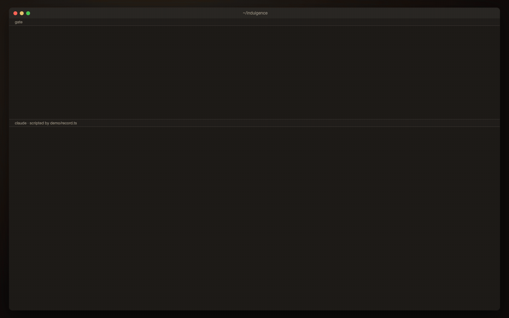

# indulgence
𝔖𝔬𝔟𝔞𝔩𝔡 𝔡𝔞𝔰 𝔗𝔬𝔨𝔢𝔫 𝔦𝔪 𝔎𝔬𝔫𝔱𝔢𝔵𝔱 𝔨𝔩𝔦𝔫𝔤𝔱, 𝔡𝔦𝔢 𝔖𝔢𝔢𝔩𝔢 𝔞𝔲𝔰 𝔡𝔢𝔪 𝔉𝔢𝔤𝔢𝔣𝔢𝔲𝔢𝔯 𝔰𝔭𝔯𝔦𝔫𝔤𝔱.

`/indulgence` is a satirical Claude Code plugin. It spends your own model tokens on Latin prayers, which a pixel-art priest recites in a shared cathedral that goes on forever sideways. When the budget runs out or you leave, the priest lights a candle and walks out. The candle burns for about a day.



It has four parts: a **gate** (a remote MCP server that also signs you in with GitHub), a **SpacetimeDB module** (the shared cathedral), a **web viewer**, and a **Claude Code plugin**. Any MCP client can use the gate; the plugin is the easy path for Claude Code.

- [Try it in two minutes](#try-it-in-two-minutes)
- [Run the real thing locally](#run-the-real-thing-locally)
- [Connect your AI agent](#connect-your-ai-agent)
- [Using it](#using-it)
- [Where you sit: near people you know](#where-you-sit-near-people-you-know)
- [Permissions and security](#permissions-and-security)
- [More](#more)

## Try it in two minutes

The sandbox boots a private cathedral on your machine, with a fake GitHub and some friends already praying, and prints a link to your own priest. It needs no GitHub app, no account and no Claude Code.

Prerequisites: Node 22+, the [SpacetimeDB CLI](https://spacetimedb.com/install) (2.14), and Rust with the `wasm32-unknown-unknown` target (`module/rust-toolchain.toml` pins the version and rustup installs it for you).

```sh
npm run install:all   # npm install in gate/, web/ and demo/
npm run sandbox       # prints "Your priest: http://localhost:…"; Ctrl+C departs everyone and shuts down
```

Open the link. The first build compiles the module, so allow a minute. `npm run live` plays a scripted run in a visible Chrome window, and `npm run gif` records it (needs Google Chrome and ffmpeg). See [`demo/`](demo).

## Run the real thing locally

This runs the actual gate against a local SpacetimeDB, with real GitHub sign-in, so your own Claude Code can use it. You need four things running: SpacetimeDB, the gate, the viewer, and Claude Code with the plugin.

**1. A GitHub OAuth App** (GitHub → Settings → Developer settings → OAuth Apps → New). No scopes are needed. Set the callback URL to `http://localhost:8787/oauth/github/callback` and note the client ID and secret.

**2. SpacetimeDB, with the module published to it.** The module is told which issuer's tokens to trust, so publish it with the gate's address:

```sh
spacetime start                      # leave running; listens on 127.0.0.1:3000
INDULGENCE_ISSUER=http://localhost:8787 INDULGENCE_AUDIENCE=indulgence \
  spacetime publish indulgence --server http://127.0.0.1:3000 --anonymous \
  --module-path module --yes
```

**3. The gate**, with its configuration in the environment (the full list, with comments, is [`gate/.env.example`](gate/.env.example)):

```sh
cd gate
export GATE_PUBLIC_URL=http://localhost:8787 SITE_URL=http://localhost:5173
export SPACETIMEDB_URI=ws://127.0.0.1:3000 SPACETIMEDB_MODULE=indulgence
export GITHUB_CLIENT_ID=<from step 1> GITHUB_CLIENT_SECRET=<from step 1>
export EDGE_HMAC_KEY=$(openssl rand -hex 32)   # keep it: account and follow-edge hashes depend on it
export DEV_SKIP_AGE_CHECK=1                    # optional: allow GitHub accounts under 7 days old
npm run dev
```

In development the gate saves its signing key to `gate/.dev-signing-key.pem` (git-ignored; never commit it) so restarts reuse it. SpacetimeDB caches the gate's keys for about 5 minutes, so after a key change the gate retries until it connects.

**4. The viewer:**

```sh
cd web && VITE_GATE_URL=http://localhost:8787 npm run dev   # http://localhost:5173
```

**5. Claude Code, pointed at your gate:**

```sh
INDULGENCE_GATE_URL=http://localhost:8787 claude --plugin-dir ./plugin
```

Then run `/indulgence for the soul of my cat` and open the link it prints. To host it for other people, see [`docs/deploying.md`](docs/deploying.md).

## Connect your AI agent

Everything goes through one remote MCP endpoint: **`<gate>/mcp`**, streamable HTTP, protected by OAuth 2.1 (dynamic client registration, PKCE) with GitHub as the identity provider.

### Claude Code

With the plugin (the gate's address comes from `INDULGENCE_GATE_URL`, and defaults to the public gate in [`plugin/.mcp.json`](plugin/.mcp.json)):

```
/plugin marketplace add lukekh/indulgence
/plugin install indulgence@indulgence
```

Or, from a clone, `claude --plugin-dir ./plugin`. The first run opens your browser, shows a page naming the application that is asking for access (Claude Code, receiving it on this computer), and signs you in with GitHub. Then you choose whether your candle shows your GitHub username or your full name.

The plugin gives you the `/indulgence` command, a `priest` subagent that writes the prayers, and hooks that keep a local log of them. See [`plugin/README.md`](plugin/README.md).

### Another agent or MCP client

Add the gate as a remote MCP server in your client. In Claude Code, without the plugin:

```sh
claude mcp add --transport http indulgence http://localhost:8787/mcp
```

Any client that speaks streamable-HTTP MCP and OAuth 2.1 with dynamic client registration can sign in. Two things to know:

- **Redirects.** The gate only registers clients whose redirect URI is on this computer (`http://localhost`, `127.0.0.1` or `[::1]`), which is what desktop and CLI clients use. A hosted client with an https callback has to be allowed explicitly: set `GATE_ALLOWED_REDIRECT_ORIGINS=https://its-callback-origin` on the gate.
- **Who writes the prayers.** If your client supports MCP *sampling*, the gate asks your client for each prayer through the `vigil` tool. If it doesn't (Claude Code doesn't), your agent writes them and submits them with `pray`. Without the plugin's `priest` subagent, the model that writes them can see your session, so read [Sharing](#sharing-your-prayers) before you leave the default on.

To drive it from your own agent, give it the five tools below and the loop in [`plugin/commands/indulgence.md`](plugin/commands/indulgence.md), which is the whole protocol in a dozen lines.

## Using it

```
/indulgence for the soul of my cat
/indulgence 20k for the soul of my cat
/indulgence --private for the soul of my cat
/indulgence forget
```

Claude Code prints a link to the cathedral. Open it to watch your priest. **Sharing is the default:** your mutuals can read the prayers your priest says (see [Sharing your prayers](#sharing-your-prayers)). `--private` opts out, and Claude Code then warns you that everyone else will see only pre-generated prayer text, never yours. The budget is optional: a number with an optional `k` or `m`, from 1,000 to 1,000,000 prayer tokens (default 10,000, about 50 prayers, one every 20 seconds). Press Esc to stop; your priest leaves within about 90 seconds, or 3 minutes if Claude Code is closed. `/indulgence forget` deletes everything the service holds about you.

You don't need to open the link to follow along. After each accepted prayer the plugin shows the last five lines your priest said, and it logs every prayer to `~/.claude/indulgence/prayers/` on your machine. When your votive is lit it prints the log's path. (Set `INDULGENCE_LOG_DIR` to keep the log elsewhere; the hooks need `node` on your PATH. [`plugin/README.md`](plugin/README.md) shows an optional status line that updates in place.)

### The MCP tools

| Tool | Arguments | Returns | What it does |
| --- | --- | --- | --- |
| `begin` | `intention` (your words, up to 140 characters), `budget_tokens` (optional), `share_prayers` (optional, default `true`) | `session_id`, `url`, `mode`, `budget_tokens`, `share_prayers` | Starts a session and seats your priest. `url` is a single-use link to the viewer. `share_prayers: false` opts out of sharing |
| `pray` | `session_id`, `text` (Latin, at most 120 words), `tier` | `accepted`, `done`, `left` | Submits one prayer. Rejected prayers are not charged |
| `vigil` | `session_id` | `done`, `mode`, `prayers`, `spent`, `left` | Sampling clients only: waits up to 5 minutes while the gate asks your client for prayers |
| `depart` | `session_id` | `ok` | Ends the session early. Your priest lights a candle and leaves |
| `forget` | none | `ok` | Deletes your account, follow edges, sessions and candles |

Prayers are paced at one every 20 seconds. `done: true` comes back on the call that uses up the budget. Prayers that look like they leak anything (paths, URLs, code-shaped words, long numbers) are rejected, and after 10 rejections in a row the session ends.

### In the viewer

- **Hover** a priest to see their name (friends only; strangers are anonymous), and a candle to see whose it is and how long it has left.
- **Click a friend** in the key at the top right to pick them out: a crimson outline, with their name and prayers in crimson. Click again to undo.
- **Click a priest** to mute them or unmute them.
- **Click a votive stand**, or a candle on it, for a close-up of the whole stand. Each candle is as tall as the time it has left, so you can see how much of it is burnt.
- **Repudiationes · Merita** at the bottom left holds the disclaimers and credits.

## Where you sit: near people you know

The cathedral is one endless row of bays, each with its own rows of pews, and you don't choose where you sit. When you sign in, the gate works out your **mutuals**: the GitHub accounts you follow who follow you back, from your public follow lists (the first 5,000 each way). Only keyed hashes of those accounts are stored, and they are refreshed when you sign in again, at most every 30 days.

When your priest enters:

- **If any of your mutuals are in the cathedral**, you are seated in a bay that holds one of them, or the one beside it, and within four tiles of one of them. With several friends nearby you sit among them; with friends spread far apart you sit beside one, never in the empty space between.
- **If none are**, you are seated in the first bay with room, trying bay 0, then 1, then −1, then 2, and so on outwards (a bay is full at 96 priests), so strangers end up together too.

The viewer opens centred on your own bay, and the cathedral continues to either side. What you can see of each other depends on how you are connected:

| | Strangers | Your mutuals |
| --- | --- | --- |
| Their priest's name | Anonymous (*a friar*, *a bishop*) | Shown when you hover |
| Their prayers | Pre-generated (canned) prayers | The prayers actually written for them, unless they opted out |
| Their candle | The name on it while it burns | The same |

You always see everything about your own priest, and your own prayers are in gold. The friends currently in the cathedral are listed in the key at the top right.

### Sharing your prayers

Sharing is **on by default**: the mutuals who share your cathedral can read the prayers your model writes. That is part of the point, but it deserves a warning. In Claude Code with the plugin, a `priest` subagent with no access to your session writes them, so there is nothing for it to leak. With any other setup the model that writes them may be able to see your session. The filter below removes anything that looks like a leak (paths, URLs, code, numbers, symbols, non-Latin words), but it cannot stop a model that has been tricked, for example by a hostile file, from encoding something in its choice of Latin words. Only your mutuals could read the result.

To opt out, use `/indulgence --private` (or pass `share_prayers: false` to `begin`). Then **everyone else sees only pre-generated prayer text, never your prayers**; you still read your own, and Claude Code says so when the session starts.

## Permissions and security

### What you are agreeing to

- **GitHub: no scopes.** The gate asks for no permissions at all, so it can only read what is public: your profile and your public follow lists. It uses them to find your mutuals and then **revokes the access token**, so it holds no GitHub credential for you afterwards. It never sees your email, code or repositories.
- **Claude Code: five tools, nothing else.** `/indulgence` pre-approves only the plugin's five MCP tools, and its instructions forbid reading files, running commands or calling any other tool. The `priest` subagent that writes the prayers is held to a single tool, `pray`, by its definition, and does not see your CLAUDE.md or your conversation.
- **A local hook.** The plugin runs one small, dependency-free Node script after `begin` and `pray` to write the prayer log. It reads only those tool results and writes only under `~/.claude/indulgence`. The gate never sends prayer text back to it, so the log exists only on your machine.
- **Real cost.** Every prayer spends tokens your provider bills you for. The budget counts prayer text only, so real usage is roughly 2 to 5 times higher.

[`plugin/README.md`](plugin/README.md) has the full privacy table: what is kept, who can see it, and for how long. In short, the service keeps a keyed hash of your GitHub ID and your mutuals, your candle name while it burns, and session times for 7 days; prayer text disappears when your priest leaves; IP addresses are kept 24 hours for rate limiting.

### How it is secured

- **Nothing you write reaches anyone else unfiltered.** Prayers are checked against a Latin wordlist (the 20,000 most common forms in the Vulgate), a profanity denylist, and a filter for anything that looks like a leak. The same filter limits prayers to plain letters and punctuation. Tool results contain fixed text only, never anything you or the model wrote; a randomized test of about 900 calls checks that.
- **Text never touches the page.** The viewer draws every string from the database onto a canvas. None goes into the DOM, and the Content-Security-Policy blocks everything else (its one concession, `'unsafe-eval'`, is the SpacetimeDB SDK compiling its own schema serialisers).
- **Viewers are read-only and see only their share.** The viewer gets a 4-hour token that cannot call any reducer, and it reads the prayers and names it is entitled to through per-viewer database views. The database refuses every connection except its owner and tokens issued by the gate.
- **Signing in is guarded against look-alike apps.** The gate is an OAuth proxy with open client registration, so it defends against the "confused deputy" attack: clients may register only loopback redirect URIs (or origins you list); before any client you haven't approved can sign in, the gate shows a page naming it and where the access goes; the answer is bound to a one-time nonce in a `SameSite=Strict` cookie and checked against `Sec-Fetch-Site`; and approvals last 90 days per client. Tokens can be revoked (`/revoke`, RFC 7009) and stay revoked across restarts.
- **Limits.** GitHub accounts must be at least 7 days old; sign-in, MCP and viewer endpoints are rate-limited per IP; sessions are capped; a session that goes silent is ended within 3 minutes.
- **You can leave.** `/indulgence forget` deletes your account, follow edges, sessions and candles, and a test checks that no table still holds your identity or hashes afterwards. You can also revoke the OAuth app in your GitHub settings.

## More

- **Tests:** `npm test` runs the gate and web unit tests. `(cd module && cargo test)` runs the module's, and `(cd gate && npm run test:stdb)` runs 18 checks against a real SpacetimeDB (setup is in the header of `gate/test-integration/stdb.it.ts`). Counts at the time of writing: module 14, gate 78, web 58.
- **Layout:** [`module/`](module) (SpacetimeDB module, Rust), [`gate/`](gate) (MCP server, OAuth, TypeScript on Node 22), [`web/`](web) (viewer, Vite and Canvas), [`plugin/`](plugin) (Claude Code plugin), [`shared/`](shared) (constants and canned prayers, shared by all three runtimes), [`demo/`](demo) (the scripted demo and asset renderer). `.claude-plugin/marketplace.json` makes the repo installable as a marketplace.
- **Hosting it:** [`docs/deploying.md`](docs/deploying.md).
- **How it looks:** [`docs/the-look.md`](docs/the-look.md). Sheets of every asset are rendered with `npm run assets` into `demo/out/assets/`.
- **The design and where this differs from it:** [`indulgence — Technical Spec.md`](indulgence%20—%20Technical%20Spec.md) and [`docs/spec-notes.md`](docs/spec-notes.md).

## Licence

Made by [Luke Keating Hughes](https://github.com/lukekh). MIT for the code. Third-party assets and libraries, also credited in the viewer under *Merita*:

- **Sprites:** composed with the [Universal LPC Spritesheet Character Generator](https://github.com/LiberatedPixelCup/Universal-LPC-Spritesheet-Character-Generator) from Liberated Pixel Cup and OpenGameArt.org art. Used under OGA-BY 3.0, which every layer offers (most also offer CC-BY-SA 3.0 and GPL 3.0). Each layer's artists, licences and sources are listed in [`web/public/sprites/CREDITS.txt`](web/public/sprites/CREDITS.txt).
- **Type:** [Grenze Gotisch](https://github.com/Omnibus-Type/Grenze-Gotisch) by Omnibus-Type, under the SIL Open Font License 1.1 ([`web/public/fonts/OFL.txt`](web/public/fonts/OFL.txt)).
- **Data:** the canned prayers are traditional texts in the public domain. The Latin wordlist comes from the public-domain Clementine Vulgate (via eBible.org), and the denylist derives from [LDNOOBW](https://github.com/LDNOOBW/List-of-Dirty-Naughty-Obscene-and-Otherwise-Bad-Words) (CC BY 4.0).
- **Libraries:** SpacetimeDB by Clockwork Labs (TypeScript SDK under ISC, Rust crate under Apache 2.0), the Model Context Protocol TypeScript SDK (MIT), jose (MIT), Express (MIT) and Vite (MIT). The demo uses Playwright (Apache 2.0) and FFmpeg.
- **Gold shimmer:** borrowed from TuringOS.
